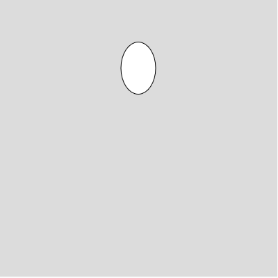

# Using the p5js editor to create a canvas 

We are going to use the p5js code editor to start with a blank canvas.  If you don't know how to do that, go and look at [post001](http://127.0.0.1:4000/ps5js/canvas/2026/11/02/lines.html).

This link will take you to the [P5JS Editor](https://editor.p5js.org/) where you should log in.  Note that if you don't create an account, you can't save your work.

## Drawing an ellipse

P5JS provides us with a command to draw an ellipse.  We need to tell it where the centre of the ellipse should be and we should provide its height and width.  Note that if the height and width are equal, then we would draw a circle.

Go to the [P5JS Editor](https://editor.p5js.org/) and create a new project.  The code will look like this:
```javascript
function setup() {
  createCanvas(400, 400);
  // Help blind or low-vision users understand your sketch
  describe("A 400 by 400 pixel gray canvas.");
}

function draw() {
  background(220);
}
```

Now we will change the `draw` function to display an ellipse on top of the background.  The centre of the ellipse will be at the point `(200,100)` and it will be `50` pixels wide and `75` pixels tall.  Your new `draw` function should look like this:
```javascript
function draw() {
  background(220);
  ellipse(200,100,50,75);
}
```
In the `ellipse` command above, `200` is the X coordinate of the ellipse and `100` is the Y coordinate of the ellipse.  The value `50` is the width of the ellipse and `75` is its height.

Your sketch should look like this:



## The coordinate system

The `createCanvas` command created a canvas that is `400` pixels wide and `400` pixels tall.  The coordinate system allows us to identify each pixel position on the canvas using its X position along the width of the canvas and its Y position along the height of the canvas.  The top left hand corner of the canvas has an X coordinate of 0 and a Y coordinate of 0.  Lets move our ellipse to the top left hand corner of the canvas:
```javascript
ellipse(0,0,50,75);
```
To put the ellipse at the top right, we need to specify an X coordinate equal to the width of the canvas (in this case `400`) and a Y coordinate of 0.
```javascript
ellipse(400,0,50,75);
```
P5JS has a special name for the value of the width of the canvas so we don't have to look back to the `createCanvas` command to see what it was.  The special name is (unsurprisingly) `width`.  The following command is therefore the same as the one above.
```javascript
ellipse(width,0,50,75);
```
To put the ellipse at the bottom left, we specify an X coordinate of 0 and a Y coordinate equal to the height of the canvas which was `400`.
```javascript
ellipse(0,400,50,75);
```
Again P5JS has a special name for the height of the canvas so we don't need to remember the actual number.  That special name is `height`.
```javascript
ellipse(0,height,50,75);
```
To put the ellipse at the bottom right of the canvas we can use:
```javascript
ellipse(width,height,50,75);
```
To put the ellipse at the centre of the canvas we can use the expressions `width/2` (width divided by 2) and `height/2` (height divided by 2):
```javascript
ellipse(width/2, height/2, 50,75);
```
### Summary

Every pixel has an X and a Y coordinate

The X coordinate of pixels on the left side of the canvas is `0` and the value of the X coordinate of the pixels increases as we move to the right of the canvas, up to whatever the `width` of the canvas is.  It doesn't really make sense to think of pixels whose X coordinate is greater than the value of `width` because we can't see them, although P5JS allows us to draw off the canvas without generating an error.

The Y coordinate of pixels on the top side of the canvas is `0` and the value of the Y coordinates of the pixels increases as we move down to the bottom of the canvas, up to whatever the `height` of the canvas is.  It doesn't really make sense to think of pixels whose Y coordinate is greater than the value of `height` because we can't see them, although P5JS allows us to draw off the canvas without generating an error.

## Resize the ellipse

If you edited your code as we updated the position of the ellipse above, your code should look like this (if not, edit your code so that it looks like the code below):
```javascript
function setup() {
  createCanvas(400, 400);
  // Help blind or low-vision users understand your sketch
  describe("A 400 by 400 pixel gray canvas.");
}

function draw() {
  background(220);
  ellipse(width/2, height/2, 50,75);
}
```

Your first task is to resize the ellipse so that its height and width are both equal to 60.

## Variables

The special words `width` and `height` are what we call variables.  They are a word that stands for a number and the value of that number may change (in this case depending on the dimensions of the canvas).

We can create our own variables.  To use a variable we should first **declare** it and then **assign a value to it** and then we can use it in our code.  Lets create a variable with the name `xp` to hold the value of the X coordinate of our ellipse.

### Declaring our variable

To declare a variable, we write `let` followed by the name of the variable followed by a semi-colon.  Our `xp` variable should be declared like this:

```javascript
let xp;

function setup() {
  createCanvas(400, 400);
  // Help blind or low-vision users understand your sketch
  describe("A 400 by 400 pixel gray canvas.");
}
```

### Assigning a value to our variable

To assign a value to a variable we put the name of the variable, followed by an `=` followed by the value we want to assign it.  To assign the value `width/2` to our `xp` variable, we should do that in the `setup` part of our code:
```javascript
let xp;

function setup() {
  createCanvas(400, 400);
  // Help blind or low-vision users understand your sketch
  describe("A 400 by 400 pixel gray canvas.");
  xp = width/2;
}
```


### Using our variable

After declaring it and assigning a value, we just write the name of the variable where we need it.  In this case as part of our `ellipse` command:

```javascript
let xp;

function setup() {
  createCanvas(400, 400);
  // Help blind or low-vision users understand your sketch
  describe("A 400 by 400 pixel gray canvas.");
  xp = width/2;
}

function draw() {
  background(220);
  ellipse(xp, height/2, 60, 60);
}
```

Edit your code to use the `xp` variable.  The sketch should look exactly the same as it was before we used the variable.

### What is the point

We will now see that the point is that we can change the value of a variable to make things happen in our sketch.  In the code below we add `1` to the value of `xp` in the `draw` function.  The `draw` function is actually called 20 times a second so adding 1 to `xp` happens again and again.  We need to click the stop button  otherwise the program runs forever with the circle disappearing off the right hand side of the canvas.

```javascript
function draw() {
  background(220);
  ellipse(xp, height/2, 60, 60);
  xp = xp + 1;
}
```

### Moving to the left

Click the stop button and make the change to `xp` subtract `1` rather than adding `1`:
```javascript
xp = xp - 1;
```
This time you should see the circle move to the left and again you need to click the stop button  to stop your program running.

### Summary

The `draw` function is called over and over again and by making changes to variables we can animate our sketch.  Currently we need to click the stop button when our animation disappears off the canvas.

## Making decisions

It would be nice if we could keep our circle on the canvas instead of having it disappear off the right or left side.  In order to do that we need to make a decision about the direction that the circle is moving.  We would like to specify that when the circle is moving to the right, when its position is equal to `width`, the direction should reverse and it should move back to the left.  When its position is equal to 0, the direction should again reverse so the circle moves back to the right.

### Keeping track of the direction

We need a variable to keep track of the direction because we need to change it.  Our variable will be called `direction`, we assign it the value `1` in the `setup` and we use it when we update `xp`.  Here is the code

```javascript
let xp;
let direction;

function setup() {
  createCanvas(400, 400);
  // Help blind or low-vision users understand your sketch
  describe("A 400 by 400 pixel gray canvas.");
  xp = width/2;
  direction = 1;
}

function draw() {
  background(220);
  ellipse(xp, height/2, 60, 60);
  xp = xp + direction;
}
```

### Reversing the direction

Our plan is that "if the value of `xp` is equal to `width`, the direction should be reversed".  We write that in p5JS in our `draw` function like this:
```javascript
function draw() {
  background(220);
  ellipse(xp, height/2, 60, 60);
  xp = xp + direction;
  if (xp == width) {
    direction = -1;
  }
}
```
The `if` command allows us to specify a **boolean condition** which in this case is `(xp == width)`.  The `==` operator means "is equal to".  This is different to writing `xp = width` which would assign the value `width` to `xp`.  Make sure you always use `==` in boolean expressions.  

A boolean condition should have a result which is either `True` or `False`.  In the example below, the code assigning a new value to `direction` will only be run when our condition is `True`, meaning the value of `xp` is equal to the value of `width`. 
```javascript
if (xp == width) {
    direction = -1;
}
```
Note that adding `-1` is the same as subtracting `1`. The expression `xp = xp + direction` will therefore **decrease** the value of `xp` when `direction` has the value `-1`.

Try it for yourself.   The circle should "bounce" off the right hand side of the canvas and then disappear off the left hand side of the canvas.  Press the stop button to end the program.

### Bouncing back from the left

To stop our circle disappearing off the left hand side of the canvas, we need to write another `if` statement that says "if the value of `xp` is equal to `0`, the value of `direction` should be reversed".  Here is the new version of `draw` which implements that:

```javascript
function draw() {
  background(220);
  ellipse(xp, height/2, 60, 60);
  xp = xp + direction;
  if (xp == width) {
    direction = -1;
  }
  if (xp == 0) {
    direction = 1;
  }
}
```

Try running this version, your circle should now stay on the canvas and bounce "forever", or at least until you click the stop button.

## Summary

1.  Every pixel on the canvas is identified by an X and Y coordinate.  The X values go from `0` to `width` (left to right) and the Y values go from `0` to `height` (top to bottom).
1.  The `draw` method is called every 20th of a second.
1.  We can **declare** variables that will stand for important values in our code.
1.  Variables need to have a value assigned to them before we can use them.  We use the `=` operator to assign a value to a variable.
1.  We can use variables in our code in place of the number
1.  Updating a variable's value allows us to animate our sketch.
1.  The `if` statement uses a boolean expression that evaluates to `True` or `False`.  We specify some code to run when the boolean expression is `True`.  That code is not executed when the expression is `False`.
1.  In a boolean expression, we use `==` which means `is equal to`.
